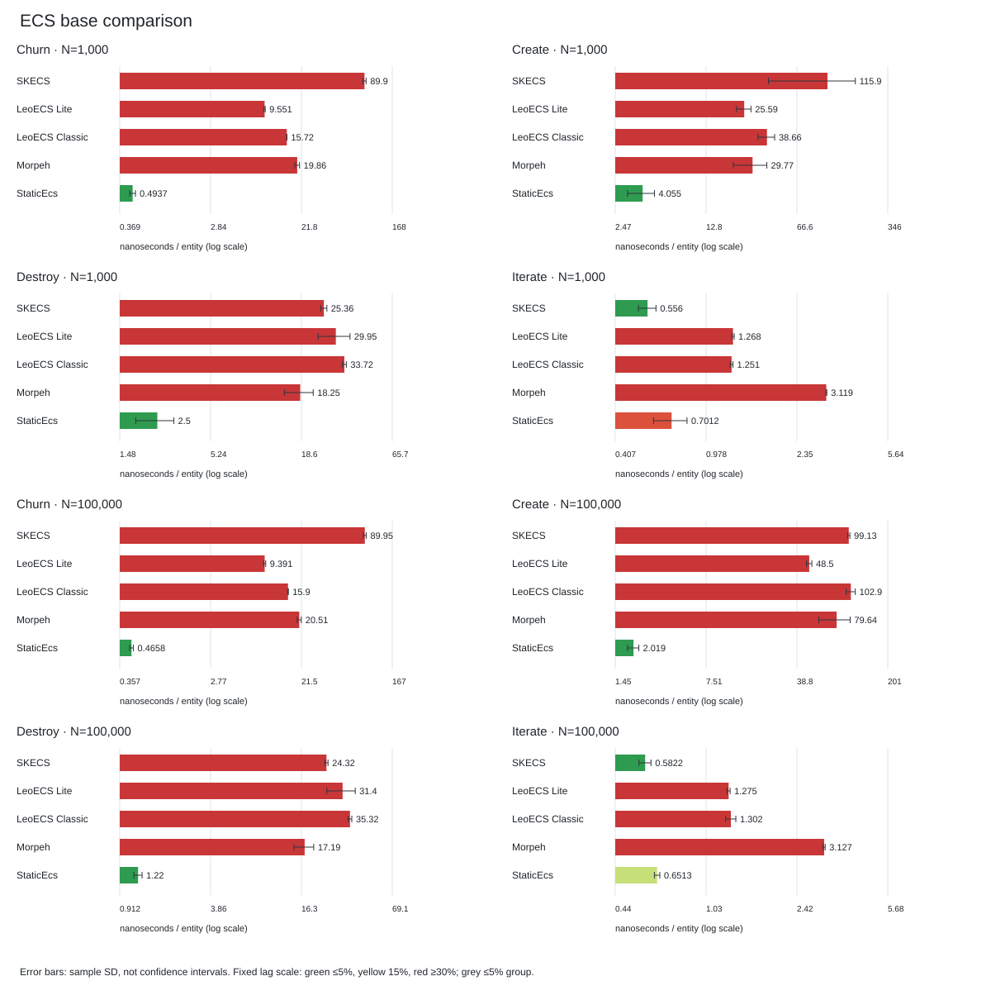

[English](README.md) | Русский

# Бенчмарки SKECS и сравнение ECS

[Репозиторий](../README.ru.md) | [Текущий отчёт](../docs/benchmarks/current/REPORT.ru.md) | [Дополнение](../docs/benchmarks/current/SUPPLEMENT.ru.md) | [Бенчмарки SpaceBattle](../SpaceBattle.Benchmarks/README.ru.md) | [Лицензии](../THIRD_PARTY_NOTICES.ru.md)

Один исполняемый .NET 8 проект объединяет бенчмарки SKECS, сравнение пяти ECS, генерацию исходников, проверки и анализ результатов. Нагрузки SpaceBattle находятся в отдельном `SpaceBattle.Benchmarks`.

`comparison` выполняет 40 базовых и 70 стресс-кейсов для SKECS, LeoECS Lite, LeoECS Classic, Morpeh и StaticEcs. `supplement` выполняет 34 стандартных и 51 расширенный кейс BenchmarkDotNet SKECS, 10 API-кейсов и 21 диагностику хранилища. `all` объединяет только эти ECS-наборы.



## Каталог исходников

| Фреймворк | Реализация базовой нагрузки | Стресс-реализация | Нативное хранилище SpaceBattle | Исходники runtime |
| --- | --- | --- | --- | --- |
| SKECS | [SkecsWorkload](Comparison/Adapters.cs), обёртка [ComparisonWorkload](Workloads/ComparisonWorkload.cs) | [SkecsStressBackend](Workloads/SkecsStressBackend.cs) | [SkecsStore](../SpaceBattle.SKECS/SkecsStore.cs) | [SKECS](../SKECS/) |
| LeoECS Lite | [LiteWorkload](Comparison/Adapters.cs) | [LiteStressBackend](Comparison/StressAdapters.cs) | [LeoEcsLiteStore](../SpaceBattle.Adapters/LeoEcsLiteStore.cs) | [ecslite/src](Vendor/Sources/ecslite/src/) |
| LeoECS Classic | [ClassicWorkload](Comparison/Adapters.cs) | [ClassicStressBackend](Comparison/StressAdapters.cs) | [LeoEcsClassicStore](../SpaceBattle.Adapters/LeoEcsClassicStore.cs) | [ecs/src](Vendor/Sources/ecs/src/) |
| Morpeh | [MorpehWorkload](Comparison/Adapters.cs) | [MorpehStressBackend](Comparison/StressAdapters.cs) | [MorpehStore](../SpaceBattle.Adapters/MorpehStore.cs) | [Morpeh Core](Vendor/Sources/morpeh/Scellecs.Morpeh/Core/) |
| StaticEcs | [StaticWorkload](Comparison/StaticAdapters.cs) | [StaticStressBackend](Comparison/StaticAdapters.cs) | [StaticEcsStore](../SpaceBattle.Adapters/StaticEcsStore.cs) | [StaticEcs/Src](Vendor/Sources/StaticEcs/Src/), [StaticPack/Src](Vendor/Sources/StaticPack/Src/) |

Проекты сборки: [SKECS.Benchmarks.csproj](SKECS.Benchmarks.csproj), [StaticLibrary.csproj](Vendor/StaticLibrary.csproj), [MorpehLibrary.csproj](Vendor/MorpehLibrary.csproj) и [SpaceBattle.Adapters.csproj](../SpaceBattle.Adapters/SpaceBattle.Adapters.csproj). StaticPack обслуживает StaticEcs и не является шестым сравниваемым фреймворком. Хранилища SpaceBattle используют общий контракт [IEcsStore](../SpaceBattle.Core/EcsContract.cs) и слой идентичности [NativeStore](../SpaceBattle.Core/NativeStore.cs); см. [контракт адаптеров](../SpaceBattle.Adapters/README.ru.md).

[Манифест vendor](Vendor/manifest.json) фиксирует исходники; `dotnet run --project SKECS.Benchmarks -c Release -- verify-vendor` проверяет распространяемый состав. Поставка содержит подмножества исходников runtime и точные upstream-лицензии, но не upstream-документацию/ассеты, бинарные NuGet-кэши или результаты сборки. Обычный клон уже содержит эти исходники и не требует скачивания vendor. `dotnet run --project SKECS.Benchmarks -c Release -- restore-vendor` необязательно восстанавливает отсутствующие файлы из закреплённых архивов. Реализация [VendorRestore.cs](Analysis/VendorRestore.cs) проверяет размеры и хеши до установки и отказывается перезаписывать изменённые локальные исходники; загрузка требует сети.

Лицензии не являются единообразно неограниченными MIT: LeoECS Classic предлагает проприетарные условия или MIT-Red, LeoECS Lite использует MIT-Red, Morpeh, StaticEcs и StaticPack используют MIT. Перед распространением прочтите [лицензионный реестр](../THIRD_PARTY_NOTICES.ru.md) и точные лицензии [Classic](Vendor/Sources/ecs/LICENSE.md), [Lite](Vendor/Sources/ecslite/LICENSE.md), [Morpeh](Vendor/Sources/morpeh/LICENSE.md), [StaticEcs](Vendor/Sources/StaticEcs/LICENSE.md), [StaticPack](Vendor/Sources/StaticPack/LICENSE.md). Этот каталог не является юридической гарантией.

## Общие нагрузки

Каталог [Workloads](Workloads/) внутри этого проекта предоставляет `ComparisonWorkload`, `StressContract`, `SkecsStressBackend`, `StressWorkload` и сгенерированный каталог сценариев раннеру и BenchmarkDotNet. Stopwatch и BenchmarkDotNet используют одни скомпилированные реализации.

[ComparisonRunner.cs](Comparison/ComparisonRunner.cs) регистрирует все пять базовых адаптеров. На 1 000 и 100 000 сущностей выполняются Create, Iterate, Churn и Destroy: Position/Velocity содержат по два float; движение прибавляет скорость к позиции; churn добавляет и затем удаляет Mass с одним float.

Перед замерами проверяются все сущности. Подготовка, заполнение мира, его освобождение и принудительный GC не измеряются; commit Morpeh включён. Каждый случай прогревается минимум 400 мс и сохраняет 20 выборок. Create/Destroy выполняют один свежий пакет на выборку; Iterate/Churn стремятся к 30 мс, максимум 1 000 повторов.

[StressRunner.cs](Comparison/StressRunner.cs), [StressContract.cs](Workloads/StressContract.cs) и [StressWorkload.cs](Workloads/StressWorkload.cs) используют одинаковые начальные данные, маски состава и порядки операций с фиксированным seed для всех пяти бэкендов. Обычная матрица: 100 000/1 000 000 сущностей, семь нагрузок, восемь выборок на случай, прогрев минимум 300 мс, до 16 повторов с целевыми 30 мс. MixedFrames выполняется один раз на выборку.

| Стресс-сценарий | Одна операция |
| --- | --- |
| DenseIteration | Перемещение всех сущностей во всех заполненных составах |
| SparseIteration | Перемещение выборки 1% с Hot |
| WideIteration | Перемещение и изменение первого/последнего полей 256-байтного компонента |
| RandomLookup | Чтение позиций в перемешанном порядке с фиксированным seed и контрольной суммой |
| PayloadChurn | Добавление и удаление 256-байтного компонента в перемешанном порядке |
| Recycle10Percent | Удаление/пересоздание 10% с восстановлением логических данных и состава |
| MixedFrames | 120 кадров: полное движение, 5% churn, 10% чтений и 1% пересозданий в каждом |

Стресс использует 256 базовых масок из восьми необязательных четырёхбайтных компонентов, 12-байтные Position/Velocity и четырёхбайтный Hot на каждой сотой сущности. Промежуточные переходы и Hot могут создавать дополнительные архетипы. MixedFrames повторяет фиксированные подмножества, а не равномерную случайную замену всей популяции.

RNG, сортировка, подготовка, проверки, освобождение и принудительный GC не измеряются. Естественный GC, вызванный измеряемыми операциями, включён.

Одинаковая логическая работа не означает одинаковую раскладку памяти, запросы или оптимальные API.

Поля аллокаций измеряют управляемые выделения в измеряемом потоке. Они исключают нативное хранилище и не отражают полный объём памяти. Погрешности на графиках показывают выборочное стандартное отклонение, не доверительные интервалы. Результаты относятся к записанной машине/runtime/ревизиям, а не к Unity/IL2CPP или универсальному рейтингу. Эксперименты с оптимизированным созданием/accessor SKECS выделены отдельно и не заменяют сравнение общих API.

Поле `machine` в JSON содержит обезличенную метку `local-machine`. Данные о
процессоре, ОС, runtime, ревизиях исходников и условиях замера сохранены для
интерпретации результатов без публикации имени компьютера.
При объединении замеров с разных компьютеров задавайте для каждого отдельную
нейтральную метку через `SKECS_BENCHMARK_MACHINE_LABEL`: значение по умолчанию
само по себе не доказывает, что запуски выполнены на одном хосте.

## Текущая кампания

[Текущий отчёт](../docs/benchmarks/current/REPORT.ru.md) содержит полную базовую/стресс-матрицу пяти ECS и SVG-графики. [Дополнение](../docs/benchmarks/current/SUPPLEMENT.ru.md) покрывает все стандартные и расширенные кейсы BenchmarkDotNet SKECS и диагностику API/storage. Машинные JSON, отдельные выборки, экспорты BenchmarkDotNet хранятся в игнорируемом `artifacts/benchmarks/current/`; Markdown и SVG публикуются в `docs/`.

## Воспроизведение

Запускайте из корня репозитория с runtime .NET 8 и SDK, поддерживающим C# 13 (9.0 или новее). Генерация, проверки, отчёты и SVG используют стандартную библиотеку .NET; Python, PowerShell, matplotlib и NumPy не нужны. Измеряемые проекты сохраняют объявленные NuGet-зависимости; offline-сборка требует кеша пакетов.

```sh
dotnet run --project SKECS.Benchmarks -c Release -- generate --check
dotnet run --project SKECS.Benchmarks -c Release -- verify-vendor
dotnet run --project SKECS.Benchmarks -c Release -- validate all
dotnet run --project SKECS.Benchmarks -c Release -- run all
dotnet run --project SKECS.Benchmarks -c Release -- report all
dotnet run --project SKECS.Benchmarks -c Release -- verify all
```

`validate` собирает Release и проверяет контракты без замеров. `run` последовательно проверяет и измеряет запрошенные наборы, сохраняет исходные данные и создаёт двуязычные отчёты. `report` проверяет локальные данные и заново создаёт публикации; `verify` проверяет данные без записи отчётов. Каждая команда принимает `comparison`, `supplement` или `all` (по умолчанию). Завершите другие сборки, бенчмарки, игры и профилировщики перед замерами.

Сырые данные по умолчанию находятся в `artifacts/benchmarks/current/micro`, публикации — в `docs/benchmarks/current`. JSON, отдельные выборки, манифесты и полные экспорты BenchmarkDotNet игнорируются Git; публикуются Markdown, SVG и итоговые таблицы.

```sh
dotnet run --project SKECS.Benchmarks -c Release -- run all --output artifacts/benchmarks/repro/micro
dotnet run --project SKECS.Benchmarks -c Release -- report all --data artifacts/benchmarks/repro/micro --output artifacts/benchmarks/repro/report
dotnet run --project SKECS.Benchmarks -c Release -- verify all --data artifacts/benchmarks/repro/micro
```

Здесь `all` использует тот же каталог micro, что и отдельные ECS-наборы. `run --output` должен находиться внутри игнорируемого `artifacts/`; `report --output` может выбрать любой каталог внутри workspace. `--root` переопределяет поиск корня. `--no-build` принимает только подтверждённую предыдущим запуском сборку с неизменёнными хешами исходников и сборок. Кеши .NET/NuGet и временные файлы находятся в `artifacts/tooling`.

## Наборы BenchmarkDotNet

[Стандартные наборы](Suites/Standard/) включают исходные итерацию/churn, общий контракт [ComparisonBenchmarks](Suites/Standard/ComparisonBenchmarks.cs) и [StressBenchmarks](Suites/Standard/StressBenchmarks.cs), а также отдельные [OptimizedApiBenchmarks](Suites/Standard/OptimizedApiBenchmarks.cs). [Расширенные наборы](Suites/Extended/) сохраняют дополнительные эксперименты SKECS. Все выполняются этим же исполняемым проектом.

```sh
dotnet run --project SKECS.Benchmarks -c Release -- bdn --suite standard --list flat
dotnet run --project SKECS.Benchmarks -c Release -- bdn --suite extended --list flat
dotnet run --project SKECS.Benchmarks -c Release -- bdn --suite all --filter '*'
```

`bdn` передаёт оставшиеся параметры BenchmarkDotNet. Для опубликованного дополнения используйте `run supplement`: фиксированный Short/InProcess, три прогревочные и восемь измеряемых итераций и полные JSON-экспорты. Изоляция InProcess отличается от стандартного toolchain. Матрица `SKECS_STRESS_EXTREME=1` на пять миллионов сущностей необязательна и не входит в стандартную кампанию. Dry/smoke проверяют выполнение и не являются полным рейтингом.

## Генерация и проверки

[Модель и шаблоны](CodeGen/README.ru.md) создают общий код адаптеров и нагрузок. После изменения входов выполните `generate`, затем `generate --check`; проверка принимает LF/CRLF и не пишет файлы. Нативные запросы и API остаются в шаблонах; диспетчеризация внутри измеряемых циклов не добавляется.

Базовая проверка проверяет данные и жизненный цикл при обоих размерах популяции. Стресс-проверка использует 257/4,097 сущностей, все семь сценариев по три повтора, добавление/удаление payload и устаревшие handles. Измеряемые стресс-кейсы проверяют всю популяцию после прогрева и выборок. Это проверки контракта нагрузки/адаптера, а не полные upstream-наборы тестов.

```sh
dotnet test tools/BenchmarkSupport.Tests/BenchmarkSupport.Tests.csproj -c Release
```
