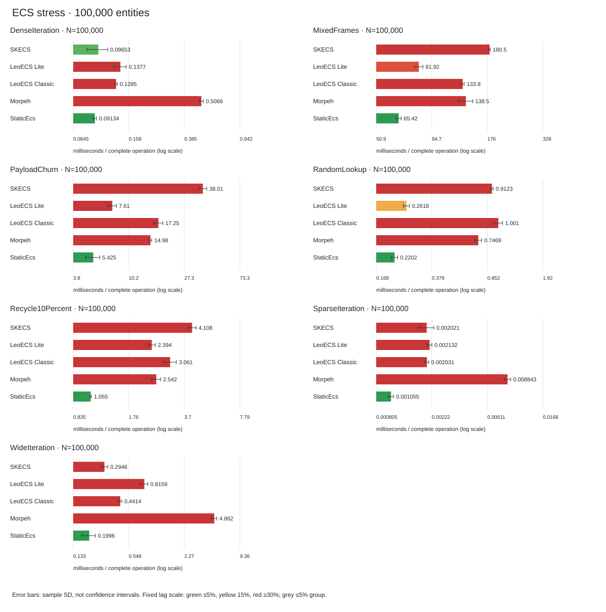
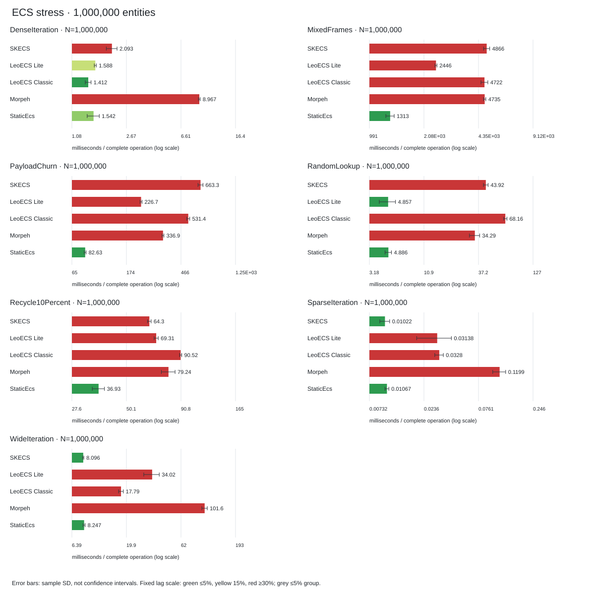

[English](REPORT.md) | Русский

# Сравнение ECS — 2026-10-18

[Обзор бенчмарков](../../../SKECS.Benchmarks/README.ru.md) | [Раннер и воспроизведение](../../../Benchmarks.Local/README.ru.md)

[Полные наборы SKECS и замеры API](SUPPLEMENT.ru.md): 34 актуальных и 51 legacy-кейс BenchmarkDotNet, создание/аксессоры и диагностика сохранённого хранилища.

Все пять фреймворков измерены заново в одной последовательной кампании: 40 базовых и 70 стресс-кейсов. Ячейки — среднее время полной операции в миллисекундах; меньше лучше. Цвет сравнивает только одинаковые сценарии и число сущностей, показывает величину эффекта, а не статистическую значимость.

Среда: .NET 8.0.32, X64, AMD Ryzen 9 9900X 12-Core Processor, 24 логических процессоров. Release; один поток; tiered compilation отключён. `9063e9d780526dc937d949a6709b33241b47a092`; рабочее дерево изменено: `True`.

Локальные артефакты `artifacts/benchmarks/current/micro`: `campaign.json` фиксирует измеренную ревизию и хеши; `base.json` и `stress.json` сохраняют все наблюдения. Хеши исходников и сборок описывают исторический измеренный снимок.

## Ревизии фреймворков в замерах

Для сторонних ECS указаны точные upstream-коммиты из проверенного по хешу `Benchmarks.Local/vendor-manifest.json`, а не предполагаемые номера релизов. Строка SKECS указывает ревизию кампании.

StaticEcs **2.2.9**; StaticPack **1.2.6** (`7bfb6cf925901b9366dda884258d727a89fff76e`). Манифест содержит SHA-256 каждого включённого upstream-файла.

| Framework | Source revision |
| --- | --- |
| SKECS | `9063e9d780526dc937d949a6709b33241b47a092` |
| LeoECS Lite | `5053141d7d663c6b1855c8409ac93dfac807b239` |
| LeoECS Classic | `1213c31c9ef8325d48e74a52b345c4db242d038b` |
| Morpeh | `9f6369384792a01d74df24efd35b08ae313e4f12` |
| StaticEcs | `23b1cf36d89497e8a126d38459d688e2b0a5dea3` |

## Измеренные средние

| Scenario | N | SKECS | LeoECS Lite | LeoECS Classic | Morpeh | StaticEcs |
| --- | --- | --- | --- | --- | --- | --- |
| Churn | 1,000 |  0.0899 |  0.009551 |  0.0157 |  0.0199 |  0.000494 |
| Create | 1,000 |  0.1159 |  0.0256 |  0.0387 |  0.0298 |  0.004055 |
| Destroy | 1,000 |  0.0254 |  0.0299 |  0.0337 |  0.0182 |  0.002500 |
| Iterate | 1,000 |  0.000556 |  0.001268 |  0.001251 |  0.003119 |  0.000701 |
| Churn | 100,000 |  8.995 |  0.9391 |  1.590 |  2.051 |  0.0466 |
| Create | 100,000 |  9.913 |  4.850 |  10.295 |  7.964 |  0.2019 |
| Destroy | 100,000 |  2.432 |  3.140 |  3.532 |  1.719 |  0.1220 |
| Iterate | 100,000 |  0.0582 |  0.1275 |  0.1302 |  0.3127 |  0.0651 |

| Scenario | N | SKECS | LeoECS Lite | LeoECS Classic | Morpeh | StaticEcs |
| --- | --- | --- | --- | --- | --- | --- |
| DenseIteration | 100,000 |  0.0965 |  0.1377 |  0.1285 |  0.5066 |  0.0913 |
| MixedFrames | 100,000 |  180.459 |  81.917 |  133.770 |  138.522 |  65.421 |
| PayloadChurn | 100,000 |  38.008 |  7.610 |  17.249 |  14.983 |  5.425 |
| RandomLookup | 100,000 |  0.9123 |  0.2618 |  1.001 |  0.7469 |  0.2202 |
| Recycle10Percent | 100,000 |  4.108 |  2.394 |  3.061 |  2.542 |  1.055 |
| SparseIteration | 100,000 |  0.002021 |  0.002132 |  0.002031 |  0.008843 |  0.001055 |
| WideIteration | 100,000 |  0.2946 |  0.8159 |  0.4414 |  4.862 |  0.1996 |
| DenseIteration | 1,000,000 |  2.093 |  1.588 |  1.412 |  8.967 |  1.542 |
| MixedFrames | 1,000,000 |  4866.246 |  2445.866 |  4721.919 |  4734.567 |  1313.287 |
| PayloadChurn | 1,000,000 |  663.326 |  226.729 |  531.399 |  336.882 |  82.633 |
| RandomLookup | 1,000,000 |  43.921 |  4.857 |  68.160 |  34.294 |  4.886 |
| Recycle10Percent | 1,000,000 |  64.304 |  69.308 |  90.520 |  79.243 |  36.925 |
| SparseIteration | 1,000,000 |  0.0102 |  0.0314 |  0.0328 |  0.1199 |  0.0107 |
| WideIteration | 1,000,000 |  8.096 |  34.024 |  17.793 |  101.590 |  8.247 |

### Цветовая шкала

 до 5% ·  15% ·  от 30% ·  нейтрально.

Цвет показывает отставание от лучшего значения в сопоставимой группе: зелёный → жёлтый → красный. Если вся группа укладывается в 5%, она серая. Цвет описывает размер различия, а не статистическую значимость. [Правила сравнения](../COLORS.ru.md).

## Графики и интерпретация

Погрешности показывают стандартное отклонение выборки, а не доверительный интервал. База сохраняет 20 замеров, стресс — 8. Подготовка, проверки, освобождение и принудительный GC исключены; естественные сборки и Morpeh Commit внутри операций включены. Create/Destroy используют свежие миры; остальные нагрузки — прогретое хранилище. MixedFrames — пакет 120 кадров, а не один кадр. Аллокации — управляемые выделения текущего потока, без нативной памяти.

Перед таймингом базовая проверка прошла для пяти фреймворков при 1,000/100,000 сущностей. Стресс-проверка прошла при 257/4,097 сущностей: семь сценариев по три повтора, round-trip payload и устаревшие handles. Каждый стресс-кейс прошёл итоговую проверку всей популяции. Перед генерацией проверены точные матрицы, хеши входных данных, число замеров, среднее, стандартное отклонение и аллокации.

Это эквивалентные логические операции через выбранные адаптеры, а не одинаковое хранилище или лучшие возможные API. Результаты относятся к этой машине, runtime, снимкам и нагрузке. Они не устанавливают универсальный рейтинг ECS, Unity/IL2CPP-производительность, эффективность полной памяти или межплатформенный детерминизм. Близкие средние нельзя считать надёжной победой без дополнительных экспериментов.

## Сохранённая история

Предыдущие прогоны пяти ECS: `artifacts/benchmarks/history/Benchmarks.Local/results-all-updated.json`, `artifacts/benchmarks/history/Benchmarks.Local/stress-all-updated.json`, [charts](../updated/comparison.png). Отдельный [эксперимент оптимизации](../optimization-methodology.ru.md) использует сохранённые исторические бинарники. Это не текущая кампания и не доказательство сегодняшнего улучшения до/после.
