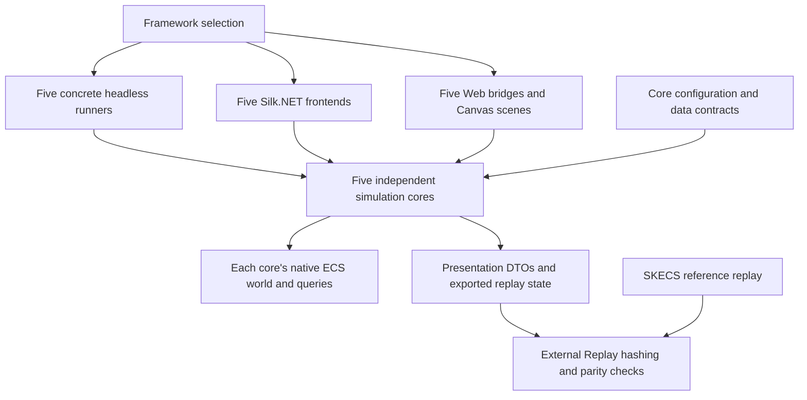

English | [Русский](ARCHITECTURE.ru.md)

# Current SpaceBattle Architecture

[Overview](README.md) | [Current report](REPORT.md)

Each framework owns its complete simulation in `SpaceBattle.Simulations`: SKECS,
LeoECS Lite, LeoECS Classic, Morpeh and StaticEcs. Hosts select a concrete
implementation before simulation begins. Gameplay logic, physics and native ECS
queries run in that implementation; tick parity is checked by software outside it.

## Projects and Data Flow

[`SpaceBattle.Simulations`](../../SpaceBattle.Simulations) has separate `Skecs`,
`LeoEcsLite`, `LeoEcsClassic`, `Morpeh` and `StaticEcs` directories. Each owns its
`Battle`, combat, AI, lifecycle, spatial structures, physics and `NativeWorld`
implementation. There is no production `Battle<TStore>`, `IEcsStore` dispatch,
identity-remapping dictionary or shared simulation superclass. `EntityKey`
contains a native identity and generation; stable gameplay serials define replay
ordering independently of native IDs. Morpeh's native handle lookup is indexed
by native ID; it does not assign another logical identity.

[`SpaceBattle.Core`](../../SpaceBattle.Core) provides common configuration,
component/data definitions, catalogues and presentation contracts. Its retained
generic battle, [`SpaceBattle.SKECS`](../../SpaceBattle.SKECS) and
[`SpaceBattle.Adapters`](../../SpaceBattle.Adapters/README.md) support focused
compatibility/regression fixtures. Production hosts do not route ticks through them.

[Headless runners](../../SpaceBattle.Benchmarks/Measurement/Headless) each call
one concrete core directly. [Game](../../SpaceBattle.Game/README.md) has a separate
app, scene renderer and profiler per framework. [Web](../../SpaceBattle.Web/README.md)
has a separate C# bridge and Canvas scene per framework. Shared OpenGL primitives,
assets, UI helpers and DTO definitions do not select or abstract the simulation.
`Capture` creates ship/turret presentation lists and omits docked ships and their
mounts from visible rows. Rendered, ship and total ECS counts describe different populations.

[`SpaceBattle.Replay`](../../SpaceBattle.Replay/ReplayHash.cs) computes hashes and
rejects divergence. Cores export ordered state through `CopyReplayState`; they do
not compute hashes, select an oracle or decide whether replay matches. Before a
headless measurement, a separate SKECS battle generates the reference at tick zero
and after every requested tick. Each concrete runner then checks its initial
state and every measured tick against that trace. Hash capture and comparison run
after the Step timer and per-tick allocation counter have stopped. Reference
creation, warmup, presentation and report serialization are outside Step timing;
wall duration and process memory still include harness work.

Host configuration matters: interactive clients explicitly choose LightSwarm, dispersed deployment and endless reinforcements. The default `BattleConfig` uses Uniform and legacy deployment, enables carrier replacement and leaves endless warp reinforcements off. Read the [current report](REPORT.md) for the measured headless configuration.

## One Tick: Nine Timed Stages

Each concrete [`Battle.Step`](../../SpaceBattle.Simulations/Skecs/Battle.cs) increments `Tick`, then runs these stages in order. They are timing intervals containing processors and helper work. The default tick rate is 60 ticks per second; rendering and host scheduling are outside Step.

| Stage | Responsibility |
| --- | --- |
| `collect` | Rebuild serial-ordered ship and moving-entity views, including team counts. ECS remains the component source. |
| `ai` | Prepare tactical snapshots/spatial indexes; update target locks, squad decisions, screening and modes. |
| `thermal-inventory` | Cool heat, regenerate shields and use inventory items; queue state changes. |
| `steering` | Turn and accelerate ships toward their tactical destinations. |
| `weapons` | Evaluate primary/secondary fire, aim independent turrets, then flush ordered shot requests into projectile entities and commit. |
| `carriers` | Queue production and docking changes; repair docked ships and request undocking. |
| `physics` | Synchronize ship bodies, solve circle contacts, write movement back to ECS; advance projectiles, debris and particles through component passes. |
| `hits` | Resolve damaging contacts and swept projectile/debris queries; apply shield/hull damage, create effects and queue retirements/destruction. |
| `lifecycle` | Apply state tags, docking, destruction and builds; remove attached guns/bodies; commit, compact moving rows, synchronize turrets and refresh ship views; update optional warp waves. |

The final stage includes additional commits when warp arrivals or gate effects change composition. There is no single global end-of-tick event dispatcher: `Battle` owns shot, state, build and retirement queues, each consumed at its explicit boundary. The [combat implementation](../../SpaceBattle.Simulations/Skecs/CombatSystems.cs) and [warp logic](../../SpaceBattle.Simulations/Skecs/WarpReinforcements.cs) define these boundaries.

## Component Groups

[Components.cs](../../SpaceBattle.Core/Components.cs) defines the data types; ordinary spawns attach the groups below according to entity role.

| Group | Data and role |
| --- | --- |
| Ship identity and movement | `Identity`, `Transform`, `Motion`; identity/team/class, previous/current pose and movement. |
| Durability and decisions | `Hull`, `Shield`, `Heat`, `Brain`, `CombatState`; health, thermal limits, tactical references and recent damage attribution. |
| Weapons | `Weapon`, optional `SecondaryWeapon`; mounted entities use `MountedTurret`, `Transform`, `Weapon`, `Heat`. |
| Physics binding | `Collider`, `PhysicsLink`; ship dimensions/mass and the circle body's handle. |
| Logistics and state | `Inventory`, optional `Carrier`, `Docked`, `Overheated`, `InCombat`, `Boosting`, `ShieldBroken`; payloads and component membership both influence rules. |
| Transient entities | `Projectile`, `Debris` or `Particle` with `Transform` and `Motion`; their payloads carry serials and expiration ticks. |

`InventoryItem` and `InventoryItems` are nested inventory payloads, not separate items spawned as ECS entities. The declared `Lifetime` type is not attached by the standard ship/projectile/debris/particle spawns.

Turrets are separate ECS entities bound to a parent hull, with their own targeting, heat and cadence. They have no separate ship `Identity` or physics body. The parent owns their collision immunity and lifecycle. Projectiles/debris query ship bodies along motion paths; particles are decorative. Current physics uses `circle-kernel-v1`, current guns `mounted-armament-v7`, damage `layered-weapon-damage-v1`, and AI `layered-squads-v3`.

## Mutation and Observation Boundaries

Each `NativeWorld` executes its framework's native queries and supplies live
component references to its concrete processors. Systems update existing values
and queue structural requests; shot flushing, hit effects, lifecycle and warp
spawning apply those requests at explicit boundaries. Reacquire references after
structural changes and never retain them across mutation or disposal. The
production cores use native framework rules rather than the compatibility
adapters' general mutation guards.

Morpeh's `Commit` flushes staged changes before subsequent queries. Other cores
apply native changes immediately. SKECS uses typed native queries; Lite uses
filters/pools, Classic uses typed filters, Morpeh uses filters/stashes, and
StaticEcs uses its typed world and queries. These paths belong to their cores.

Tactical snapshots and sorted views are temporary read structures; ECS remains
the component source. Each core's physics maintains its own bodies, contacts and
queries. Presentation and statistics sit outside simulation timing. Matching all
recorded tick hashes is bounded evidence for the tested configuration/runtime,
not a proof of cross-platform floating-point determinism or a complete save format.

## Changes and Validation

A logic change in any core must be applied to all five cores and their matching
frontends. Update the corresponding headless, desktop and web implementations
together, and keep configuration/contracts and replay exports synchronized.
`measure --validate-ports` checks the concrete cores against SKECS at every tick;
production headless measurements repeat this check outside the timers. Existing
focused gameplay/adapter fixtures still exercise retained compatibility code and
supplement these checks; they do not replace concrete-core replay and frontend validation.

For rule details see [tactics v3](TACTICS.md), [physics](PHYSICS.md), [armament](ARMAMENT.md), [damage](DAMAGE.md) and [reinforcements](REINFORCEMENTS.md). For capture/profiling scopes use the client engineering guides: [desktop](../../SpaceBattle.Game/DEVELOPMENT.md), [web](../../SpaceBattle.Web/DEVELOPMENT.md).
