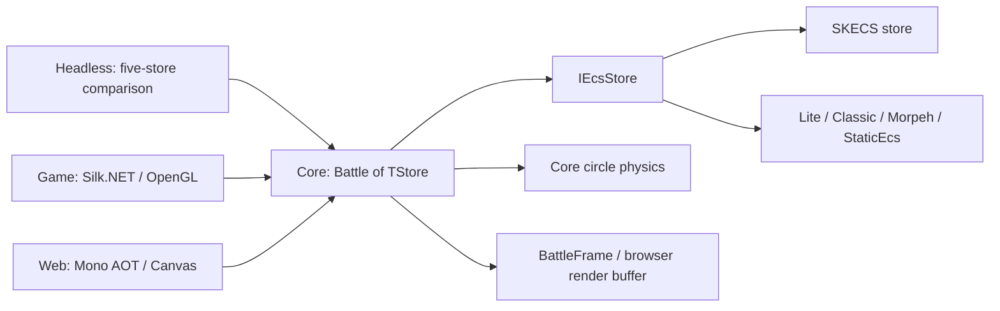

English | [Русский](ARCHITECTURE.ru.md)

# Current SpaceBattle Architecture

[Overview](README.md) | [Current report](REPORT.md)

This is a map of the current implementation. Core owns combat rules and the tick sequence; stores own ECS components and query membership; hosts decide how to advance, observe and present the battle.

## Projects and Data Flow

[Core](../../SpaceBattle.Core/Battle.cs) contains configuration, ship catalogue, AI, weapons, damage, physics and lifecycle. [SKECS integration](../../SpaceBattle.SKECS/SkecsStore.cs) and [native adapters](../../SpaceBattle.Adapters/README.md) implement the same [store contract](../../SpaceBattle.Core/EcsContract.cs) using each framework's native storage and queries. `EntityKey` carries a store-local ID and generation; gameplay serials provide stable ordering independently of native entity IDs.

[Headless](../../SpaceBattle.Benchmarks/Measurement/MeasurementProgram.cs) runs `Step`, records timing/counters/checkpoints and serializes results after measurement. [Game](../../SpaceBattle.Game/README.md) and [Web](../../SpaceBattle.Web/README.md) use SKECS. They call shared simulation and presentation APIs; the web bridge prepares a reused binary render buffer for Canvas. `Capture` builds a presentation view with separate ship/turret lists and omits docked ships from visible ship rows. Rendered, ship and total ECS counts therefore describe different populations.

Host configuration matters: interactive clients explicitly choose LightSwarm, dispersed deployment and endless reinforcements. The default `BattleConfig` uses Uniform and legacy deployment, enables carrier replacement and leaves endless warp reinforcements off. Read the [current report](REPORT.md) for the measured headless configuration.

## One Tick: Nine Timed Stages

[`Battle.Step`](../../SpaceBattle.Core/Battle.cs) increments `Tick`, then runs these stages in order. They are timing intervals containing processors and helper work. The default tick rate is 60 ticks per second; rendering and host scheduling are outside Step.

| Stage | Responsibility |
| --- | --- |
| `collect` | Rebuild serial-ordered ship and moving-entity views, including team counts. ECS remains the component source. |
| `ai` | Prepare tactical snapshots/spatial indexes; update target locks, squad decisions, screening and modes. |
| `thermal-inventory` | Cool heat, regenerate shields and use inventory items; queue state changes. |
| `steering` | Turn and accelerate ships toward their tactical destinations. |
| `weapons` | Evaluate primary/secondary fire, aim independent turrets, then flush ordered shot requests into projectile entities and commit. |
| `carriers` | Queue production and docking changes; repair docked ships and request undocking. |
| `physics` | Synchronize ship bodies, solve circle contacts, write movement back to ECS; advance projectiles, debris and particles through component passes. |
| `hits` | Resolve damaging contacts and swept projectile/debris queries; apply shield/hull damage, create effects and queue retirements/destruction. |
| `lifecycle` | Apply state tags, docking, destruction and builds; remove attached guns/bodies; commit, compact moving rows, synchronize turrets and refresh ship views; update optional warp waves. |

The final stage includes additional commits when warp arrivals or gate effects change composition. There is no single global end-of-tick event dispatcher: `Battle` owns shot, state, build and retirement queues, each consumed at its explicit boundary. The [combat implementation](../../SpaceBattle.Core/CombatSystems.cs) and [warp logic](../../SpaceBattle.Core/WarpReinforcements.cs) define these boundaries.

## Component Groups

[Components.cs](../../SpaceBattle.Core/Components.cs) defines the data types; ordinary spawns attach the groups below according to entity role.

| Group | Data and role |
| --- | --- |
| Ship identity and movement | `Identity`, `Transform`, `Motion`; identity/team/class, previous/current pose and movement. |
| Durability and decisions | `Hull`, `Shield`, `Heat`, `Brain`, `CombatState`; health, thermal limits, tactical references and recent damage attribution. |
| Weapons | `Weapon`, optional `SecondaryWeapon`; mounted entities use `MountedTurret`, `Transform`, `Weapon`, `Heat`. |
| Physics binding | `Collider`, `PhysicsLink`; ship dimensions/mass and the circle body's handle. |
| Logistics and state | `Inventory`, optional `Carrier`, `Docked`, `Overheated`, `InCombat`, `Boosting`, `ShieldBroken`; payloads and component membership both influence rules. |
| Transient entities | `Projectile`, `Debris` or `Particle` with `Transform` and `Motion`; their payloads carry serials and expiration ticks. |

`InventoryItem` and `InventoryItems` are nested inventory payloads, not separate items spawned as ECS entities. The declared `Lifetime` type is not attached by the standard ship/projectile/debris/particle spawns.

Turrets are separate ECS entities bound to a parent hull, with their own targeting, heat and cadence. They have no separate ship `Identity` or physics body. The parent owns their collision immunity and lifecycle. Projectiles/debris query ship bodies along motion paths; particles are decorative. Current physics uses `circle-kernel-v1`, current guns `mounted-armament-v7`, damage `layered-weapon-damage-v1`, and AI `layered-squads-v3`.

## Mutation and Observation Boundaries

`ForEach` exposes live component refs. Processors may update existing values and append requests; store guards reject `Create`, `Destroy`, `Set`, `Remove`, `Commit` and disposal while a query is active. Outside queries, direct structural work occurs in shot flushing, hit effects, lifecycle and warp spawning. Reacquire refs after structural changes; never keep them across mutation or disposal.

`Commit` makes staged native changes available before subsequent queries. Morpeh needs its staged flush; the other stores use immediate changes with the same guarded boundary. The optimized SKECS `ForEachComponents` path traverses native columns for work that does not need the current row's entity key; the other adapters use the keyed fallback. Both retain the mutation guard.

Tactical snapshots and sorted views are temporary read structures; they do not replace ECS storage. Physics keeps body/contact/query state synchronized with ship components. Presentation, statistics and explicit checksum requests have separate scopes. Matching recorded checksums is bounded replay evidence, not a complete snapshot or proof of cross-platform determinism.

For rule details see [tactics v3](TACTICS.md), [physics](PHYSICS.md), [armament](ARMAMENT.md), [damage](DAMAGE.md) and [reinforcements](REINFORCEMENTS.md). For capture/profiling scopes use the client engineering guides: [desktop](../../SpaceBattle.Game/DEVELOPMENT.md), [web](../../SpaceBattle.Web/DEVELOPMENT.md).
