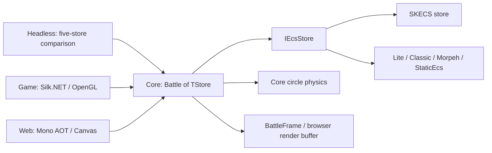

[English](ARCHITECTURE.md) | Русский

# Текущая архитектура SpaceBattle

[Обзор](README.ru.md) | [Текущий отчёт](REPORT.ru.md)

Карта текущей реализации. Core определяет правила боя и порядок тика; хранилища содержат ECS-компоненты и определяют, какие сущности входят в запросы; хосты управляют выполнением тиков, наблюдением и отображением боя.

## Проекты и поток данных

[Core](../../SpaceBattle.Core/Battle.cs) содержит конфигурацию, каталог кораблей, AI, оружие, урон, физику и lifecycle. [Интеграция SKECS](../../SpaceBattle.SKECS/SkecsStore.cs) и [native-адаптеры](../../SpaceBattle.Adapters/README.ru.md) реализуют один [контракт хранилища](../../SpaceBattle.Core/EcsContract.cs) через собственные компоненты и запросы каждого фреймворка. `EntityKey` содержит локальные ID и поколение; игровые serial задают устойчивый порядок независимо от native-ID.

[Headless](../../SpaceBattle.Benchmarks/Measurement/MeasurementProgram.cs) выполняет `Step`, записывает время/счётчики/checkpoints и сериализует результат после измерения. [Game](../../SpaceBattle.Game/README.ru.md) и [Web](../../SpaceBattle.Web/README.ru.md) используют SKECS и общие API симуляции/представления; web bridge готовит переиспользуемый бинарный буфер для Canvas. `Capture` формирует представление с отдельными списками кораблей/турелей и не включает пристыкованные корабли в видимые ship-строки. Число нарисованных объектов, кораблей и всех ECS-сущностей поэтому различается.

Конфигурация хоста существенна: интерактивные клиенты явно выбирают LightSwarm, разреженную расстановку и бесконечные подкрепления. У `BattleConfig` по умолчанию Uniform и legacy-расстановка, замена носителей включена, бесконечные warp-подкрепления выключены. Конфигурация headless-замера указана в [текущем отчёте](REPORT.ru.md).

## Один тик: девять измеряемых стадий

[`Battle.Step`](../../SpaceBattle.Core/Battle.cs) увеличивает `Tick`, затем выполняет стадии по порядку. Это интервалы замера с процессорами и вспомогательными операциями. Частота по умолчанию — 60 тиков в секунду; рендеринг и планирование хоста находятся вне Step.

| Стадия | Обязанности |
| --- | --- |
| `collect` | Пересобрать упорядоченные по serial представления кораблей и движущихся сущностей, включая числа сторон. Источником компонентов остаётся ECS. |
| `ai` | Подготовить тактические snapshots/пространственные индексы; обновить удержание целей, решения групп, прикрытие и режимы. |
| `thermal-inventory` | Охладить нагрев, восстановить щиты и применить предметы; поставить изменения состояния в очередь. |
| `steering` | Повернуть и ускорить корабли к тактическим направлениям. |
| `weapons` | Проверить главное/вторичное оружие, навести отдельные турели, затем создать снаряды по упорядоченным запросам и выполнить commit. |
| `carriers` | Поставить производство и стыковку в очередь; ремонтировать пристыкованные корабли и запросить отстыковку. |
| `physics` | Синхронизировать тела кораблей, решить круговые контакты, вернуть движение в ECS; продвинуть снаряды, обломки и частицы через component-проходы. |
| `hits` | Разрешить урон контактов и swept-запросы снарядов/обломков; применить урон щиту/корпусу, создать эффекты и запросить удаление/гибель. |
| `lifecycle` | Применить state-теги, стыковку, гибель и постройки; удалить прикреплённые орудия/тела; выполнить commit, уплотнить moving-списки, синхронизировать турели и обновить корабли; обработать включённые warp-волны. |

Последняя стадия содержит дополнительные commits при прибытиях и изменении эффектов ворот. Единого глобального диспетчера событий в конце тика нет: `Battle` владеет очередями выстрелов, состояний, построек и удалений, которые обрабатываются на своих границах. Они заданы в [боевой реализации](../../SpaceBattle.Core/CombatSystems.cs) и [warp-логике](../../SpaceBattle.Core/WarpReinforcements.cs).

## Группы компонентов

[Components.cs](../../SpaceBattle.Core/Components.cs) задаёт типы данных; обычный spawn прикрепляет группы ниже по роли сущности.

| Группа | Данные и назначение |
| --- | --- |
| Идентичность и движение корабля | `Identity`, `Transform`, `Motion`: команда/класс, предыдущая/текущая поза и движение. |
| Прочность и решения | `Hull`, `Shield`, `Heat`, `Brain`, `CombatState`: здоровье, тепловые пределы, тактические ссылки и атрибуция недавнего урона. |
| Вооружение | `Weapon`, необязательный `SecondaryWeapon`; отдельные установки используют `MountedTurret`, `Transform`, `Weapon`, `Heat`. |
| Связь с физикой | `Collider`, `PhysicsLink`: размеры/масса корабля и handle кругового тела. |
| Логистика и состояние | `Inventory`, необязательные `Carrier`, `Docked`, `Overheated`, `InCombat`, `Boosting`, `ShieldBroken`: на правила влияют и payload, и наличие компонента. |
| Временные сущности | `Projectile`, `Debris` или `Particle` с `Transform` и `Motion`; payload содержит serial и срок жизни в тиках. |

`InventoryItem` и `InventoryItems` — вложенные данные инвентаря, не самостоятельные предметы-сущности. Объявленный `Lifetime` не прикрепляется обычными spawn кораблей/снарядов/обломков/частиц.

Турели — отдельные ECS-сущности, связанные с корпусом, со своими целями, нагревом и частотой огня. У них нет отдельной ship-`Identity` или физического тела. Родитель определяет collision immunity и lifecycle. Снаряды/обломки делают запросы к телам кораблей вдоль пути; частицы декоративны. Текущая физика — `circle-kernel-v1`, орудия — `mounted-armament-v7`, урон — `layered-weapon-damage-v1`, AI — `layered-squads-v3`.

## Границы изменения и наблюдения

`ForEach` передаёт ссылки на компоненты в хранилище. Процессоры меняют существующие значения и добавляют отложенные запросы; защитные проверки запрещают `Create`, `Destroy`, `Set`, `Remove`, `Commit` и освобождение хранилища во время обхода запроса. Вне запросов состав сущностей меняется при создании выстрелов, эффектов попаданий, обработке жизненного цикла и warp-прибытиях. После структурной операции получайте ссылки заново; не используйте прежние ссылки после изменения структуры или освобождения хранилища.

`Commit` делает staged native-изменения доступными следующим запросам. Morpeh выполняет staged flush; остальные хранилища применяют изменения сразу, сохраняя общую проверяемую границу. Оптимизированный SKECS `ForEachComponents` проходит native-колонки для работы без ключа текущей строки; остальные адаптеры используют keyed fallback. В обоих путях действует mutation guard.

Тактические snapshots и сортированные представления — временные структуры чтения; они не заменяют ECS-хранилище. Физика хранит состояние тел/контактов/запросов, синхронизированное с кораблями. Представление, статистика и явные checksum-запросы имеют отдельные области. Совпадение записанных checksum — ограниченное свидетельство повтора, не полный snapshot и не доказательство кроссплатформенного детерминизма.

Правила подробнее: [тактика v3](TACTICS.ru.md), [физика](PHYSICS.ru.md), [вооружение](ARMAMENT.ru.md), [урон](DAMAGE.ru.md), [подкрепления](REINFORCEMENTS.ru.md). Области захвата/профилирования описаны в технических руководствах [desktop](../../SpaceBattle.Game/DEVELOPMENT.ru.md) и [web](../../SpaceBattle.Web/DEVELOPMENT.ru.md).
