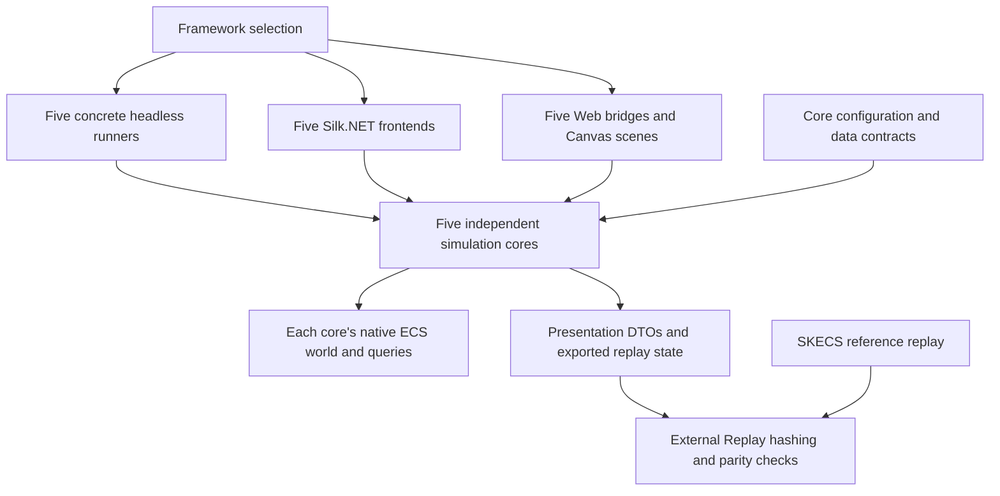

[English](ARCHITECTURE.md) | Русский

# Текущая архитектура SpaceBattle

[Обзор](README.ru.md) | [Текущий отчёт](REPORT.ru.md)

Каждый фреймворк владеет полной симуляцией в `SpaceBattle.Simulations`: SKECS,
LeoECS Lite, LeoECS Classic, Morpeh и StaticEcs. Хост выбирает конкретную
реализацию до начала боя. Она выполняет игровую логику, физику и нативные
ECS-запросы; внешнее ПО проверяет совпадение тиков.

## Проекты и поток данных

[`SpaceBattle.Simulations`](../../SpaceBattle.Simulations) содержит отдельные
каталоги `Skecs`, `LeoEcsLite`, `LeoEcsClassic`, `Morpeh`, `StaticEcs`. Каждый
содержит собственные `Battle`, бой, AI, жизненный цикл, пространственные структуры,
физику и `NativeWorld`. В реализации нет `Battle<TStore>`, диспетчера
`IEcsStore`, словаря переназначения идентификаторов или общего базового класса
симуляции. `EntityKey` содержит нативные ID и поколение; устойчивые игровые serial
задают порядок повтора независимо от нативных ID. Таблица нативных handles в
Morpeh индексируется нативным ID и не назначает дополнительную логическую идентичность.

[`SpaceBattle.Core`](../../SpaceBattle.Core) задаёт общие конфигурацию,
компоненты/данные, каталоги и контракты представления. Общего движка симуляции
и прежних вспомогательных реализаций симуляции в нём нет. Подробные проверки
механик выполняют нативное ядро SKECS; остальные нативные ядра внешнее ПО
сравнивает с SKECS в начальном состоянии и после каждого тика.

Каждый [headless-runner](../../SpaceBattle.Benchmarks/Measurement/Headless)
напрямую вызывает одно конкретное ядро. У [Game](../../SpaceBattle.Game/README.ru.md)
отдельные приложение, отрисовка сцены и профилировщик для каждого фреймворка.
У [Web](../../SpaceBattle.Web/README.ru.md) отдельные C# bridge и Canvas-сцена.
Общие примитивы OpenGL, ресурсы, UI-помощники и DTO не выбирают и не абстрагируют
симуляцию. `Capture` формирует списки кораблей/турелей и исключает пристыкованные
корабли с их установками из видимых строк. Числа нарисованных объектов, кораблей
и всех ECS-сущностей относятся к разным совокупностям.

[`SpaceBattle.Replay`](../../SpaceBattle.Replay/ReplayHash.cs) вычисляет хеши
и отклоняет несовпадения. Ядра экспортируют упорядоченное состояние через
`CopyReplayState`, но не вычисляют хеши, не выбирают эталон и не решают, совпал ли
повтор. До headless-замера отдельный бой SKECS формирует эталон для нулевого и
каждого запрошенного тика. Конкретный runner сравнивает начальное состояние и
каждый измеренный тик с этим эталоном. Экспорт/хеширование и сравнение выполняются
после остановки таймера Step и счётчика выделений на тик. Создание эталона,
прогрев, представление и сериализация отчёта исключены из времени Step; полное
время выполнения и память процесса всё ещё включают работу измеряющего ПО.

Конфигурация хоста существенна: интерактивные клиенты явно выбирают LightSwarm, разреженную расстановку и бесконечные подкрепления. У `BattleConfig` по умолчанию Uniform и legacy-расстановка, замена носителей включена, бесконечные warp-подкрепления выключены. Конфигурация headless-замера указана в [текущем отчёте](REPORT.ru.md).

## Один тик: девять измеряемых стадий

Каждый конкретный [`Battle.Step`](../../SpaceBattle.Simulations/Skecs/Battle.cs) увеличивает `Tick`, затем выполняет стадии по порядку. Это интервалы замера с процессорами и вспомогательными операциями. Частота по умолчанию — 60 тиков в секунду; рендеринг и планирование хоста находятся вне Step.

| Стадия | Обязанности |
| --- | --- |
| `collect` | Пересобрать упорядоченные по serial представления кораблей и движущихся сущностей, включая числа сторон. Источником компонентов остаётся ECS. |
| `ai` | Подготовить тактические snapshots/пространственные индексы; обновить удержание целей, решения групп, прикрытие и режимы. |
| `thermal-inventory` | Охладить нагрев, восстановить щиты и применить предметы; поставить изменения состояния в очередь. |
| `steering` | Повернуть и ускорить корабли к тактическим направлениям. |
| `weapons` | Проверить главное/вторичное оружие, навести отдельные турели, затем создать снаряды по упорядоченным запросам и выполнить commit. |
| `carriers` | Поставить производство и стыковку в очередь; ремонтировать пристыкованные корабли и запросить отстыковку. |
| `physics` | Синхронизировать тела кораблей, решить круговые контакты, вернуть движение в ECS; продвинуть снаряды, обломки и частицы через component-проходы. |
| `hits` | Разрешить урон контактов и swept-запросы снарядов/обломков; применить урон щиту/корпусу, создать эффекты и запросить удаление/гибель. |
| `lifecycle` | Применить state-теги, стыковку, гибель и постройки; удалить прикреплённые орудия/тела; выполнить commit, уплотнить moving-списки, синхронизировать турели и обновить корабли; обработать включённые warp-волны. |

Последняя стадия содержит дополнительные commits при прибытиях и изменении эффектов ворот. Единого глобального диспетчера событий в конце тика нет: `Battle` владеет очередями выстрелов, состояний, построек и удалений, которые обрабатываются на своих границах. Они заданы в [боевой реализации](../../SpaceBattle.Simulations/Skecs/CombatSystems.cs) и [warp-логике](../../SpaceBattle.Simulations/Skecs/WarpReinforcements.cs).

## Группы компонентов

[Components.cs](../../SpaceBattle.Core/Components.cs) задаёт типы данных; обычный spawn прикрепляет группы ниже по роли сущности.

| Группа | Данные и назначение |
| --- | --- |
| Идентичность и движение корабля | `Identity`, `Transform`, `Motion`: команда/класс, предыдущая/текущая поза и движение. |
| Прочность и решения | `Hull`, `Shield`, `Heat`, `Brain`, `CombatState`: здоровье, тепловые пределы, тактические ссылки и атрибуция недавнего урона. |
| Вооружение | `Weapon`, необязательный `SecondaryWeapon`; отдельные установки используют `MountedTurret`, `Transform`, `Weapon`, `Heat`. |
| Связь с физикой | `Collider`, `PhysicsLink`: размеры/масса корабля и handle кругового тела. |
| Логистика и состояние | `Inventory`, необязательные `Carrier`, `Docked`, `Overheated`, `InCombat`, `Boosting`, `ShieldBroken`: на правила влияют и payload, и наличие компонента. |
| Временные сущности | `Projectile`, `Debris` или `Particle` с `Transform` и `Motion`; payload содержит serial и срок жизни в тиках. |

`InventoryItem` и `InventoryItems` — вложенные данные инвентаря, не самостоятельные предметы-сущности. Объявленный `Lifetime` не прикрепляется обычными spawn кораблей/снарядов/обломков/частиц.

Турели — отдельные ECS-сущности, связанные с корпусом, со своими целями, нагревом и частотой огня. У них нет отдельной ship-`Identity` или физического тела. Родитель определяет collision immunity и lifecycle. Снаряды/обломки делают запросы к телам кораблей вдоль пути; частицы декоративны. Текущая физика — `circle-kernel-v1`, орудия — `mounted-armament-v7`, урон — `layered-weapon-damage-v1`, AI — `layered-squads-v3`.

## Границы изменения и наблюдения

Каждый `NativeWorld` выполняет нативные запросы своего фреймворка и передаёт
живые ссылки на компоненты своим процессорам. Системы меняют значения и
формируют структурные запросы; создание выстрелов, эффекты попаданий, жизненный
цикл и warp-прибытия применяют их на явных границах. После структурных изменений
получайте ссылки заново и не сохраняйте их после изменения или освобождения
хранилища. Ядра следуют нативным правилам изменения данных своих фреймворков.

`Commit` в Morpeh применяет отложенные изменения перед следующими запросами.
Остальные ядра применяют изменения сразу. SKECS использует типизированные
нативные запросы, Lite — filters/pools, Classic — типизированные filters,
Morpeh — filters/stashes, StaticEcs — свой типизированный мир и запросы.
Эти пути находятся внутри соответствующих ядер.

Тактические snapshots и сортированные представления временные; источником
компонентов остаётся ECS. Физика каждого ядра содержит собственные тела,
контакты и запросы. Представление и статистика находятся вне таймера симуляции.
Совпадение всех записанных хешей тиков — ограниченное свидетельство для
проверенных конфигурации/runtime, не доказательство кроссплатформенного
float-детерминизма и не полный формат сохранения.

## Изменения и проверка

Изменение логики в любом ядре должно быть перенесено во все пять ядер и
соответствующие клиенты. Обновляйте headless-, desktop- и web-реализации вместе,
синхронизируя общие конфигурацию/контракты и экспорт состояния.
`measure --validate-ports` проверяет конкретные ядра против SKECS на каждом тике;
production-замеры headless повторяют эту проверку вне таймеров. Подробные
проверки механик используют только нативное ядро SKECS; начальное состояние
и хеш каждого тика остальных нативных ядер сравниваются с SKECS внешним ПО.
Общий движок или адаптерную реализацию для тестов сохранять нельзя.
Проверки клиентов выполняют соответствующие конкретные реализации.

Правила подробнее: [тактика v3](TACTICS.ru.md), [физика](PHYSICS.ru.md), [вооружение](ARMAMENT.ru.md), [урон](DAMAGE.ru.md), [подкрепления](REINFORCEMENTS.ru.md). Области захвата/профилирования описаны в технических руководствах [desktop](../../SpaceBattle.Game/DEVELOPMENT.ru.md) и [web](../../SpaceBattle.Web/DEVELOPMENT.ru.md).
