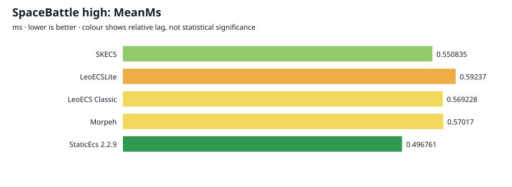
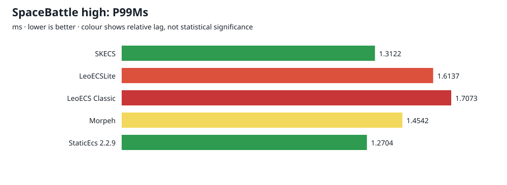
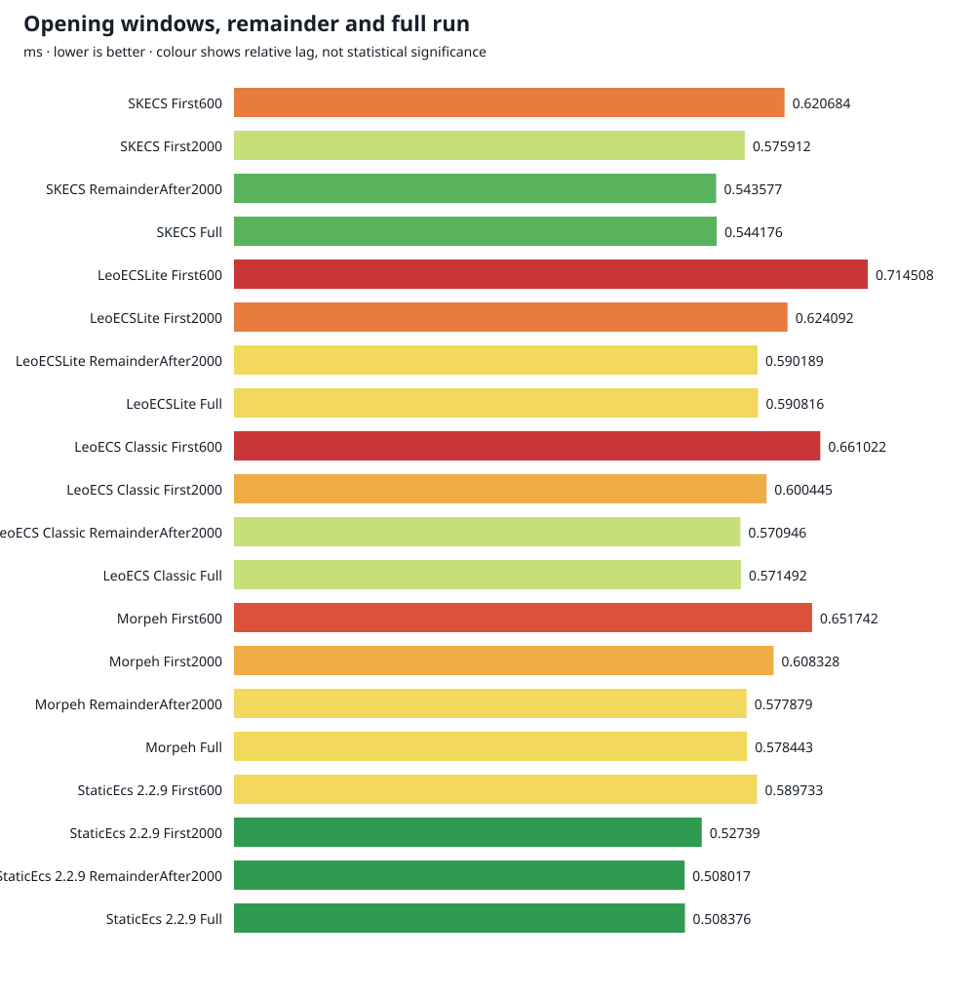

English | [Русский](REPORT.ru.md)

# Space Battle benchmarks — real-game high

Preset: `game`; profile: `high`; 2026-10-18T15:27:07.5787241+05:00 — 2026-10-18T15:34:23.4895992+05:00.

Five ECS implementations, 108,000 measured ticks each and 600 separate warmup ticks. Seed 7331, 96 escorts and 3 carriers per team; gameplay churn multiplier 2; endless reinforcements enabled.

### Colour scale

 up to 5% ·  15% ·  from 30% ·  neutral.

Colour shows lag from the best value in a comparable group: green → yellow → red. Groups entirely within 5% are grey. Colour describes effect size, not statistical significance. [Comparison rules](../benchmarks/COLORS.md).

## Validation and method

Validation passed: 540,000 raw ticks, archive/decompressed/input hashes, provenance, timings, stages, allocations, GC intervals, counters, census and per-tick gameplay parity.

Outer tick includes gameplay, physics and ECS commits; HUD and stage timers cover narrower scopes. Rendering, snapshots and report generation are excluded. One run per ECS describes this machine and does not establish a stable ranking or confidence interval. Managed allocation excludes native ECS storage.

## Framework revisions used

| ECS | Source revision | Version |
| --- | --- | --- |
| SKECS | `9063e9d780526dc937d949a6709b33241b47a092` | 0.2.0 |
| LeoECSLite | `5053141d7d663c6b1855c8409ac93dfac807b239` | 2024.5.22 |
| LeoECS Classic | `1213c31c9ef8325d48e74a52b345c4db242d038b` | 2023.6.22 |
| Morpeh | `9f6369384792a01d74df24efd35b08ae313e4f12` | 2024.1.1 |
| StaticEcs 2.2.9 | `23b1cf36d89497e8a126d38459d688e2b0a5dea3` | 2.2.9 |

StaticPack: `7bfb6cf925901b9366dda884258d727a89fff76e`.

## Tick time

| ECS | Mean ms | P95 ms | P99 ms | Max ms | >16.67 ms | Managed B/tick | Total outer s |
| --- | --- | --- | --- | --- | --- | --- | --- |
| SKECS |  0.6662 |  1.0452 |  1.3122 |  3.9294 |  0 |  601.6 |  71.954668 |
| LeoECSLite |  0.8767 |  1.3194 |  1.6137 |  4.2005 |  0 |  681.0 |  94.678999 |
| LeoECS Classic |  0.8412 |  1.3188 |  1.7073 |  4.4115 |  0 |  667.5 |  90.848046 |
| Morpeh |  0.7588 |  1.1732 |  1.4542 |  5.1162 |  0 |  655.8 |  81.947525 |
| StaticEcs 2.2.9 |  0.6536 |  1.0177 |  1.2704 |  4.1364 |  0 |  621.6 |  70.592594 |





## Opening windows

The first 600 and 2,000 windows are cumulative; the remainder is disjoint.

| ECS | 1–600 ms | 1–2000 ms | 2001–108000 ms | Full ms |
| --- | --- | --- | --- | --- |
| SKECS | 0.7655 | 0.6998 | 0.6656 | 0.6662 |
| LeoECSLite | 0.9728 | 0.9107 | 0.8760 | 0.8767 |
| LeoECS Classic | 0.9683 | 0.8982 | 0.8401 | 0.8412 |
| Morpeh | 0.8880 | 0.8239 | 0.7575 | 0.7588 |
| StaticEcs 2.2.9 | 0.7587 | 0.6957 | 0.6528 | 0.6536 |



[Summary CSV](current/summary.csv)

## Full-run stage means

| Stage | SKECS | LeoECSLite | LeoECS Classic | Morpeh | StaticEcs 2.2.9 |
| --- | --- | --- | --- | --- | --- |
| collect |  0.1798 |  0.2207 |  0.1911 |  0.1847 |  0.1732 |
| ai |  0.1089 |  0.1317 |  0.1313 |  0.1175 |  0.1055 |
| thermal-inventory |  0.0093 |  0.0139 |  0.0132 |  0.0107 |  0.0105 |
| steering |  0.0249 |  0.0292 |  0.0295 |  0.0271 |  0.0247 |
| weapons |  0.0202 |  0.0264 |  0.0240 |  0.0225 |  0.0195 |
| carriers |  0.0008 |  0.0009 |  0.0008 |  0.0008 |  0.0009 |
| physics |  0.0614 |  0.1323 |  0.1054 |  0.1131 |  0.0757 |
| hits |  0.2287 |  0.2771 |  0.2939 |  0.2456 |  0.2102 |
| lifecycle |  0.0322 |  0.0443 |  0.0518 |  0.0365 |  0.0333 |
| Battle.LastTickMs |  0.6662 |  0.8766 |  0.8411 |  0.7587 |  0.6536 |
| Outer tick |  0.6662 |  0.8767 |  0.8412 |  0.7588 |  0.6536 |

### SKECS opening stages

| Stage | 1–600 ms | 1–2000 ms | 2001–108000 ms | Full ms |
| --- | --- | --- | --- | --- |
| collect | 0.1933 | 0.1851 | 0.1797 | 0.1798 |
| ai | 0.1493 | 0.1225 | 0.1086 | 0.1089 |
| thermal-inventory | 0.0102 | 0.0091 | 0.0093 | 0.0093 |
| steering | 0.0336 | 0.0270 | 0.0248 | 0.0249 |
| weapons | 0.0270 | 0.0214 | 0.0202 | 0.0202 |
| carriers | 0.0003 | 0.0005 | 0.0008 | 0.0008 |
| physics | 0.0712 | 0.0625 | 0.0614 | 0.0614 |
| hits | 0.2443 | 0.2393 | 0.2285 | 0.2287 |
| lifecycle | 0.0363 | 0.0324 | 0.0322 | 0.0322 |

## HUD windows: first, second and common worst

The common worst window has the largest HUD mean among all five ports; each ECS uses that same tick range. Population means match across ports.

### First: 1–600

| HUD / stage ms | SKECS | LeoECSLite | LeoECS Classic | Morpeh | StaticEcs 2.2.9 |
| --- | --- | --- | --- | --- | --- |
| HUD total |  0.7654 |  0.9727 |  0.9682 |  0.8879 |  0.7586 |
| collect |  0.1933 |  0.2356 |  0.2131 |  0.2114 |  0.1914 |
| ai |  0.1493 |  0.1687 |  0.1757 |  0.1589 |  0.1446 |
| thermal-inventory |  0.0102 |  0.0156 |  0.0156 |  0.0128 |  0.0128 |
| steering |  0.0336 |  0.0397 |  0.0378 |  0.0369 |  0.0328 |
| weapons |  0.0270 |  0.0344 |  0.0316 |  0.0289 |  0.0247 |
| carriers |  0.0003 |  0.0004 |  0.0004 |  0.0003 |  0.0010 |
| physics |  0.0712 |  0.1431 |  0.1231 |  0.1287 |  0.0823 |
| hits |  0.2443 |  0.2852 |  0.3086 |  0.2673 |  0.2361 |
| lifecycle |  0.0363 |  0.0499 |  0.0624 |  0.0427 |  0.0329 |

| Ships | Projectiles | Debris | Particles | Turrets |
| --- | --- | --- | --- | --- |
| 104.26 | 818.02 | 859.90 | 1558.18 | 48.44 |

### Second: 601–1200

| HUD / stage ms | SKECS | LeoECSLite | LeoECS Classic | Morpeh | StaticEcs 2.2.9 |
| --- | --- | --- | --- | --- | --- |
| HUD total |  0.8683 |  1.1630 |  1.1922 |  1.0274 |  0.8842 |
| collect |  0.2331 |  0.2912 |  0.2627 |  0.2438 |  0.2317 |
| ai |  0.1505 |  0.1853 |  0.1940 |  0.1710 |  0.1481 |
| thermal-inventory |  0.0102 |  0.0167 |  0.0170 |  0.0141 |  0.0135 |
| steering |  0.0299 |  0.0351 |  0.0380 |  0.0338 |  0.0305 |
| weapons |  0.0227 |  0.0298 |  0.0300 |  0.0256 |  0.0232 |
| carriers |  0.0006 |  0.0007 |  0.0008 |  0.0007 |  0.0008 |
| physics |  0.0798 |  0.1723 |  0.1538 |  0.1542 |  0.1010 |
| hits |  0.3002 |  0.3752 |  0.4112 |  0.3331 |  0.2882 |
| lifecycle |  0.0411 |  0.0568 |  0.0845 |  0.0511 |  0.0472 |

| Ships | Projectiles | Debris | Particles | Turrets |
| --- | --- | --- | --- | --- |
| 100.58 | 970.01 | 1513.26 | 1386.75 | 44.51 |

### Worst: 601–1200

| HUD / stage ms | SKECS | LeoECSLite | LeoECS Classic | Morpeh | StaticEcs 2.2.9 |
| --- | --- | --- | --- | --- | --- |
| HUD total |  0.8683 |  1.1630 |  1.1922 |  1.0274 |  0.8842 |
| collect |  0.2331 |  0.2912 |  0.2627 |  0.2438 |  0.2317 |
| ai |  0.1505 |  0.1853 |  0.1940 |  0.1710 |  0.1481 |
| thermal-inventory |  0.0102 |  0.0167 |  0.0170 |  0.0141 |  0.0135 |
| steering |  0.0299 |  0.0351 |  0.0380 |  0.0338 |  0.0305 |
| weapons |  0.0227 |  0.0298 |  0.0300 |  0.0256 |  0.0232 |
| carriers |  0.0006 |  0.0007 |  0.0008 |  0.0007 |  0.0008 |
| physics |  0.0798 |  0.1723 |  0.1538 |  0.1542 |  0.1010 |
| hits |  0.3002 |  0.3752 |  0.4112 |  0.3331 |  0.2882 |
| lifecycle |  0.0411 |  0.0568 |  0.0845 |  0.0511 |  0.0472 |

| Ships | Projectiles | Debris | Particles | Turrets |
| --- | --- | --- | --- | --- |
| 100.58 | 970.01 | 1513.26 | 1386.75 | 44.51 |

## Gameplay parity, census and tactical counters

Checksum: `7EE0B6054181F4AE`.

| Counter | Value |
| --- | --- |
| ShipsCreated | 17469 |
| ShipsDestroyed | 17380 |
| Shots | 945589 |
| Hits | 728514 |
| PlasmaShieldHits | 54703 |
| ShieldBreaks | 29274 |
| Overheats | 6921 |
| Dockings | 2104 |
| Repairs | 411441 |
| Builds | 4466 |
| ItemUses | 30884 |
| DebrisHits | 637983 |
| Explosions | 17380 |
| StructuralAdds | 21128346 |
| StructuralRemoves | 21115896 |
| AimDecisions | 561298 |
| ImpreciseAimDecisions | 140481 |
| FriendlyFireHits | 282792 |
| SelfHits | 0 |
| HeavyShots | 1623 |
| TurretShots | 109331 |
| ReinforcementWaves | 198 |
| ReinforcementShips | 12805 |
| ReinforcementPlacementChecks | 22573 |
| TargetSwitches | 174153 |
| TargetRetentions | 271162 |
| GroupOrders | 38483 |
| CoverOrders | 6864 |
| GroupChanges | 44950 |
| FormationReviews | 20005 |
| CompatibilityChecks | 1732000 |
| ScoreEvaluations | 9127135 |
| SpatialWork | 24715259 |
| BudgetFallbacks | 71 |
| IntentProjectiles | 67984535 |

## Memory and store census

Peak samples across 30 minute checkpoints; store entities include gameplay entities only. Process memory includes harness buffers.

| ECS | Managed heap MiB | Working set MiB | Private MiB | Native MiB | Accessor MiB | Entities final | Archetypes final | Chunks final |
| --- | --- | --- | --- | --- | --- | --- | --- | --- |
| SKECS | 39.71 | 80.19 | 62.71 | 7.04 | 0.00 | 3820 | 81 | 119 |
| LeoECSLite | 45.61 | 78.98 | 70.51 | n/a | n/a | 3820 | n/a | n/a |
| LeoECS Classic | 45.38 | 77.53 | 70.81 | n/a | n/a | 3820 | n/a | n/a |
| Morpeh | 44.86 | 85.88 | 80.02 | n/a | n/a | 3820 | n/a | n/a |
| StaticEcs 2.2.9 | 42.23 | 83.80 | 58.20 | n/a | n/a | 3820 | n/a | n/a |

### Minute population census

| Tick | Ships | Projectiles | Debris | Particles | Turrets |
| --- | --- | --- | --- | --- | --- |
| 3600 |  49 |  547 |  1426 |  747 |  44 |
| 7200 |  91 |  453 |  1425 |  2027 |  40 |
| 10800 |  66 |  755 |  1345 |  1164 |  44 |
| 14400 |  91 |  827 |  1369 |  726 |  50 |
| 18000 |  100 |  609 |  1253 |  578 |  46 |
| 21600 |  103 |  532 |  1271 |  1415 |  44 |
| 25200 |  84 |  354 |  1188 |  393 |  52 |
| 28800 |  93 |  698 |  1233 |  1641 |  56 |
| 32400 |  65 |  478 |  1440 |  880 |  48 |
| 36000 |  82 |  770 |  1325 |  1301 |  58 |
| 39600 |  61 |  314 |  1243 |  496 |  52 |
| 43200 |  73 |  490 |  1177 |  774 |  40 |
| 46800 |  113 |  418 |  858 |  790 |  70 |
| 50400 |  103 |  777 |  1427 |  1392 |  50 |
| 54000 |  110 |  1429 |  1211 |  3808 |  50 |
| 57600 |  98 |  254 |  1138 |  471 |  54 |
| 61200 |  97 |  1052 |  1461 |  1949 |  50 |
| 64800 |  104 |  798 |  1265 |  1420 |  48 |
| 68400 |  62 |  378 |  1364 |  303 |  40 |
| 72000 |  100 |  617 |  1567 |  916 |  40 |
| 75600 |  96 |  456 |  1096 |  1090 |  44 |
| 79200 |  98 |  559 |  1345 |  907 |  50 |
| 82800 |  64 |  734 |  1288 |  1062 |  46 |
| 86400 |  66 |  450 |  997 |  496 |  38 |
| 90000 |  47 |  438 |  1408 |  489 |  52 |
| 93600 |  83 |  953 |  1417 |  1936 |  36 |
| 97200 |  98 |  637 |  1084 |  1310 |  46 |
| 100800 |  72 |  432 |  1363 |  1932 |  48 |
| 104400 |  72 |  887 |  1525 |  618 |  36 |
| 108000 |  89 |  918 |  1340 |  1425 |  48 |

## Data provenance and reproduction

Runtime: .NET 8.0.32; OS: Microsoft Windows 10.0.26200; tiered compilation `0`.

Base commit: `9063e9d780526dc937d949a6709b33241b47a092`. Source and loaded DLL hashes describe the measured working tree.


Local lossless gzip archives retain the full tick CSV; archive and decompressed SHA256 hashes are recorded in the local manifest. Analysis reads gzip directly and requires only .NET 8.


```sh
dotnet run --project tools/BenchmarkTools -- report space-battle --data artifacts/benchmarks/current/space-battle --output docs/space-battle/current
```

[Desktop timing](DESKTOP_TIMING.md) · [Architecture](ARCHITECTURE.md) · [Historical finite battle](REPORT_2026-10-14_FINITE.md)

Local measurement inputs: `artifacts/benchmarks/current/space-battle`.
Base commit: `9063e9d780526dc937d949a6709b33241b47a092`.
RAM: 61.49 GiB.
CPU: AMD Ryzen 9 9900X 12-Core Processor            .
