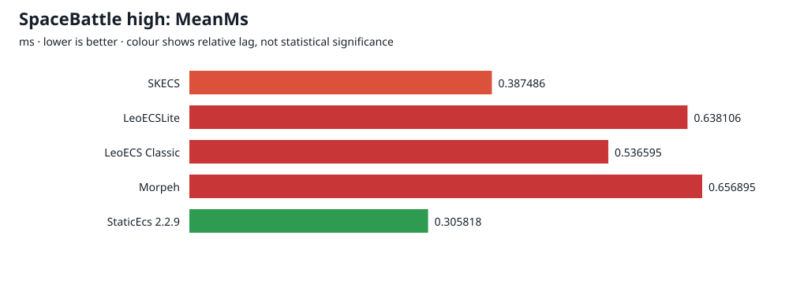
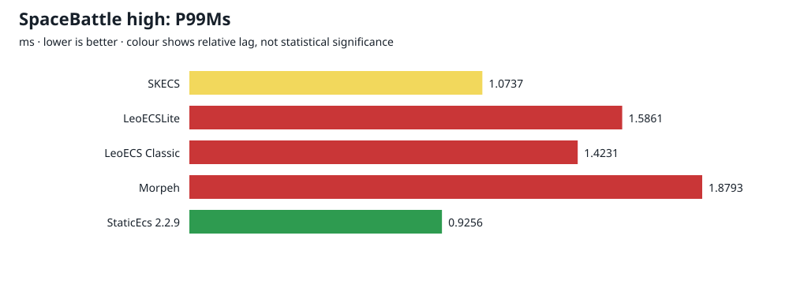
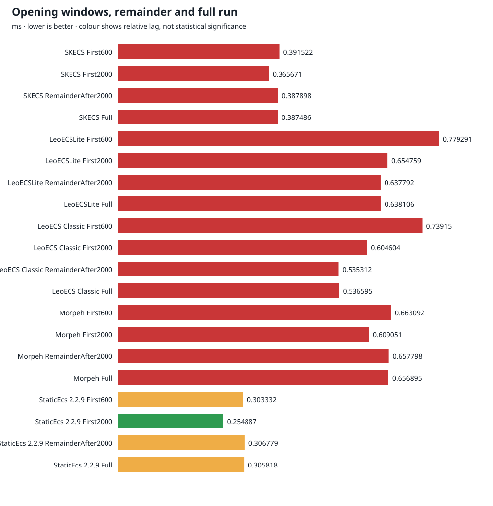

English | [Русский](REPORT.ru.md)

# Space Battle benchmarks — real-game high

Preset: `game`; profile: `high`; 2026-11-24T08:27:13.8070421+00:00 — 2026-11-24T08:38:43.3254183+00:00.

Five independent native ECS cores, 108,000 measured ticks each and 600 separate warmup ticks. Seed 7331, 96 escorts and 3 carriers per team; gameplay churn multiplier 2; endless reinforcements enabled.

### Colour scale

 up to 5% ·  15% ·  from 30% ·  neutral.

Colour shows lag from the best value in a comparable group: green → yellow → red. Groups entirely within 5% are grey. Colour describes effect size, not statistical significance. [Comparison rules](../benchmarks/COLORS.md).

## Validation and method

Validation passed: 540,000 raw ticks, archive/decompressed/input hashes, provenance, timings, stages, allocations, GC intervals, counters, census and per-tick state-hash parity against SKECS.

Outer tick includes gameplay, physics and ECS commits; HUD and stage timers cover narrower scopes. Rendering, state capture, replay hashing/comparison and report generation are excluded. Every initial state and tick is compared with a SKECS replay generated in a separate process before the 600-tick warmup; hashes include gameplay component state, pending reinforcements and counters. One run per ECS describes this machine and does not establish a stable ranking or confidence interval. Managed allocation excludes native ECS storage.

## Framework revisions used

| ECS | Source revision | Version |
| --- | --- | --- |
| SKECS | `a18443101ca1a27191745b979c32518eab4d058d` | 0.2.0 |
| LeoECSLite | `5053141d7d663c6b1855c8409ac93dfac807b239` | 2024.5.22 |
| LeoECS Classic | `1213c31c9ef8325d48e74a52b345c4db242d038b` | 2023.6.22 |
| Morpeh | `9f6369384792a01d74df24efd35b08ae313e4f12` | 2024.1.1 |
| StaticEcs 2.2.9 | `23b1cf36d89497e8a126d38459d688e2b0a5dea3` | 2.2.9 |

StaticPack: `7bfb6cf925901b9366dda884258d727a89fff76e`.

## Tick time

| ECS | Mean ms | P95 ms | P99 ms | Max ms | >16.67 ms | Managed B/tick | Total outer s |
| --- | --- | --- | --- | --- | --- | --- | --- |
| SKECS |  0.3875 |  0.7655 |  1.0737 |  9.0559 |  0 |  616.6 |  41.848539 |
| LeoECSLite |  0.6381 |  1.1754 |  1.5861 |  5.2985 |  0 |  699.1 |  68.915440 |
| LeoECS Classic |  0.5366 |  1.0276 |  1.4231 |  8.8131 |  0 |  681.3 |  57.952254 |
| Morpeh |  0.6569 |  1.2288 |  1.8793 |  34.9796 |  8 |  677.5 |  70.944696 |
| StaticEcs 2.2.9 |  0.3058 |  0.6618 |  0.9256 |  6.0490 |  0 |  606.0 |  33.028393 |





## Opening windows

The first 600 and 2,000 windows are cumulative; the remainder is disjoint.

| ECS | 1–600 ms | 1–2000 ms | 2001–108000 ms | Full ms |
| --- | --- | --- | --- | --- |
| SKECS | 0.3915 | 0.3657 | 0.3879 | 0.3875 |
| LeoECSLite | 0.7793 | 0.6548 | 0.6378 | 0.6381 |
| LeoECS Classic | 0.7391 | 0.6046 | 0.5353 | 0.5366 |
| Morpeh | 0.6631 | 0.6091 | 0.6578 | 0.6569 |
| StaticEcs 2.2.9 | 0.3033 | 0.2549 | 0.3068 | 0.3058 |



[Summary CSV](current/summary.csv)

## Full-run stage means

| Stage | SKECS | LeoECSLite | LeoECS Classic | Morpeh | StaticEcs 2.2.9 |
| --- | --- | --- | --- | --- | --- |
| collect |  0.0174 |  0.0253 |  0.0341 |  0.0407 |  0.0048 |
| ai |  0.1178 |  0.1804 |  0.1401 |  0.1711 |  0.1130 |
| thermal-inventory |  0.0090 |  0.0152 |  0.0104 |  0.0124 |  0.0044 |
| steering |  0.0274 |  0.0392 |  0.0311 |  0.0366 |  0.0233 |
| weapons |  0.0197 |  0.0323 |  0.0217 |  0.0265 |  0.0108 |
| carriers |  0.0011 |  0.0012 |  0.0007 |  0.0016 |  0.0008 |
| physics |  0.0426 |  0.0788 |  0.0618 |  0.1188 |  0.0498 |
| hits |  0.1238 |  0.1971 |  0.1765 |  0.1837 |  0.0840 |
| lifecycle |  0.0286 |  0.0683 |  0.0601 |  0.0653 |  0.0147 |
| Battle.LastTickMs |  0.3874 |  0.6379 |  0.5364 |  0.6567 |  0.3057 |
| Outer tick |  0.3875 |  0.6381 |  0.5366 |  0.6569 |  0.3058 |

### SKECS opening stages

| Stage | 1–600 ms | 1–2000 ms | 2001–108000 ms | Full ms |
| --- | --- | --- | --- | --- |
| collect | 0.0173 | 0.0162 | 0.0175 | 0.0174 |
| ai | 0.1399 | 0.1185 | 0.1177 | 0.1178 |
| thermal-inventory | 0.0074 | 0.0075 | 0.0091 | 0.0090 |
| steering | 0.0295 | 0.0260 | 0.0274 | 0.0274 |
| weapons | 0.0196 | 0.0178 | 0.0197 | 0.0197 |
| carriers | 0.0002 | 0.0005 | 0.0011 | 0.0011 |
| physics | 0.0385 | 0.0378 | 0.0427 | 0.0426 |
| hits | 0.1127 | 0.1155 | 0.1240 | 0.1238 |
| lifecycle | 0.0263 | 0.0257 | 0.0287 | 0.0286 |

## HUD windows: first, second and common worst

The common worst window has the largest HUD mean among all five ports; each ECS uses that same tick range. Population means match across ports.

### First: 1–600

| HUD / stage ms | SKECS | LeoECSLite | LeoECS Classic | Morpeh | StaticEcs 2.2.9 |
| --- | --- | --- | --- | --- | --- |
| HUD total |  0.3914 |  0.7791 |  0.7389 |  0.6629 |  0.3032 |
| collect |  0.0173 |  0.0313 |  0.0396 |  0.0409 |  0.0043 |
| ai |  0.1399 |  0.2457 |  0.2225 |  0.1995 |  0.1303 |
| thermal-inventory |  0.0074 |  0.0152 |  0.0137 |  0.0117 |  0.0038 |
| steering |  0.0295 |  0.0468 |  0.0440 |  0.0386 |  0.0227 |
| weapons |  0.0196 |  0.0397 |  0.0323 |  0.0271 |  0.0108 |
| carriers |  0.0002 |  0.0007 |  0.0005 |  0.0008 |  0.0004 |
| physics |  0.0385 |  0.0903 |  0.0808 |  0.1101 |  0.0413 |
| hits |  0.1127 |  0.2232 |  0.2198 |  0.1695 |  0.0767 |
| lifecycle |  0.0263 |  0.0863 |  0.0855 |  0.0645 |  0.0128 |

| Ships | Projectiles | Debris | Particles | Turrets |
| --- | --- | --- | --- | --- |
| 104.26 | 818.02 | 859.90 | 1558.18 | 48.44 |

### Second: 601–1200

| HUD / stage ms | SKECS | LeoECSLite | LeoECS Classic | Morpeh | StaticEcs 2.2.9 |
| --- | --- | --- | --- | --- | --- |
| HUD total |  0.5015 |  0.8275 |  0.7161 |  0.7222 |  0.3217 |
| collect |  0.0212 |  0.0344 |  0.0439 |  0.0473 |  0.0048 |
| ai |  0.1615 |  0.2468 |  0.1954 |  0.2007 |  0.1213 |
| thermal-inventory |  0.0100 |  0.0187 |  0.0126 |  0.0124 |  0.0039 |
| steering |  0.0340 |  0.0465 |  0.0375 |  0.0375 |  0.0221 |
| weapons |  0.0224 |  0.0365 |  0.0256 |  0.0257 |  0.0107 |
| carriers |  0.0008 |  0.0011 |  0.0008 |  0.0014 |  0.0006 |
| physics |  0.0556 |  0.1050 |  0.0847 |  0.1272 |  0.0518 |
| hits |  0.1582 |  0.2505 |  0.2314 |  0.1974 |  0.0885 |
| lifecycle |  0.0377 |  0.0881 |  0.0842 |  0.0725 |  0.0180 |

| Ships | Projectiles | Debris | Particles | Turrets |
| --- | --- | --- | --- | --- |
| 100.58 | 970.01 | 1513.26 | 1386.75 | 44.51 |

### Worst: 25201–25800

| HUD / stage ms | SKECS | LeoECSLite | LeoECS Classic | Morpeh | StaticEcs 2.2.9 |
| --- | --- | --- | --- | --- | --- |
| HUD total |  0.4581 |  0.8318 |  0.7115 |  1.2909 |  0.4400 |
| collect |  0.0186 |  0.0294 |  0.0412 |  0.0600 |  0.0068 |
| ai |  0.1664 |  0.2760 |  0.2211 |  0.3713 |  0.1853 |
| thermal-inventory |  0.0102 |  0.0207 |  0.0139 |  0.0240 |  0.0061 |
| steering |  0.0356 |  0.0600 |  0.0474 |  0.0725 |  0.0362 |
| weapons |  0.0207 |  0.0397 |  0.0268 |  0.0494 |  0.0134 |
| carriers |  0.0010 |  0.0011 |  0.0007 |  0.0034 |  0.0010 |
| physics |  0.0490 |  0.0961 |  0.0794 |  0.2276 |  0.0659 |
| hits |  0.1267 |  0.2296 |  0.2078 |  0.3203 |  0.1047 |
| lifecycle |  0.0299 |  0.0791 |  0.0732 |  0.1624 |  0.0206 |

| Ships | Projectiles | Debris | Particles | Turrets |
| --- | --- | --- | --- | --- |
| 115.89 | 756.05 | 1239.28 | 1417.06 | 53.13 |

## Gameplay parity, census and tactical counters

Checksum: `80F8AC31F06DDEBA`.

| Counter | Value |
| --- | --- |
| ShipsCreated | 17469 |
| ShipsDestroyed | 17380 |
| Shots | 945589 |
| Hits | 728514 |
| PlasmaShieldHits | 54703 |
| ShieldBreaks | 29274 |
| Overheats | 6921 |
| Dockings | 2104 |
| Repairs | 411441 |
| Builds | 4466 |
| ItemUses | 30884 |
| DebrisHits | 637983 |
| Explosions | 17380 |
| StructuralAdds | 21128346 |
| StructuralRemoves | 21115896 |
| AimDecisions | 561298 |
| ImpreciseAimDecisions | 140481 |
| FriendlyFireHits | 282792 |
| SelfHits | 0 |
| HeavyShots | 1623 |
| TurretShots | 109331 |
| ReinforcementWaves | 198 |
| ReinforcementShips | 12805 |
| ReinforcementPlacementChecks | 22573 |
| TargetSwitches | 174153 |
| TargetRetentions | 271162 |
| GroupOrders | 38483 |
| CoverOrders | 6864 |
| GroupChanges | 44950 |
| FormationReviews | 20005 |
| CompatibilityChecks | 1732000 |
| ScoreEvaluations | 9127135 |
| SpatialWork | 24715259 |
| BudgetFallbacks | 71 |
| IntentProjectiles | 67984535 |

## Memory and store census

Peak samples across 30 minute checkpoints; store entities include gameplay entities only. Process memory includes harness buffers.

| ECS | Managed heap MiB | Working set MiB | Private MiB | Native MiB | Accessor MiB | Entities final | Archetypes final | Chunks final |
| --- | --- | --- | --- | --- | --- | --- | --- | --- |
| SKECS | 46.95 | 98.19 | 76.41 | 7.04 | 0.00 | 3820 | 81 | 119 |
| LeoECSLite | 51.82 | 94.32 | 78.78 | n/a | n/a | 3820 | n/a | n/a |
| LeoECS Classic | 51.74 | 98.70 | 82.70 | n/a | n/a | 3820 | n/a | n/a |
| Morpeh | 51.44 | 105.07 | 90.97 | n/a | n/a | 3820 | n/a | n/a |
| StaticEcs 2.2.9 | 45.23 | 92.77 | 66.05 | n/a | n/a | 3820 | n/a | n/a |

### Minute population census

| Tick | Ships | Projectiles | Debris | Particles | Turrets |
| --- | --- | --- | --- | --- | --- |
| 3600 |  49 |  547 |  1426 |  747 |  44 |
| 7200 |  91 |  453 |  1425 |  2027 |  40 |
| 10800 |  66 |  755 |  1345 |  1164 |  44 |
| 14400 |  91 |  827 |  1369 |  726 |  50 |
| 18000 |  100 |  609 |  1253 |  578 |  46 |
| 21600 |  103 |  532 |  1271 |  1415 |  44 |
| 25200 |  84 |  354 |  1188 |  393 |  52 |
| 28800 |  93 |  698 |  1233 |  1641 |  56 |
| 32400 |  65 |  478 |  1440 |  880 |  48 |
| 36000 |  82 |  770 |  1325 |  1301 |  58 |
| 39600 |  61 |  314 |  1243 |  496 |  52 |
| 43200 |  73 |  490 |  1177 |  774 |  40 |
| 46800 |  113 |  418 |  858 |  790 |  70 |
| 50400 |  103 |  777 |  1427 |  1392 |  50 |
| 54000 |  110 |  1429 |  1211 |  3808 |  50 |
| 57600 |  98 |  254 |  1138 |  471 |  54 |
| 61200 |  97 |  1052 |  1461 |  1949 |  50 |
| 64800 |  104 |  798 |  1265 |  1420 |  48 |
| 68400 |  62 |  378 |  1364 |  303 |  40 |
| 72000 |  100 |  617 |  1567 |  916 |  40 |
| 75600 |  96 |  456 |  1096 |  1090 |  44 |
| 79200 |  98 |  559 |  1345 |  907 |  50 |
| 82800 |  64 |  734 |  1288 |  1062 |  46 |
| 86400 |  66 |  450 |  997 |  496 |  38 |
| 90000 |  47 |  438 |  1408 |  489 |  52 |
| 93600 |  83 |  953 |  1417 |  1936 |  36 |
| 97200 |  98 |  637 |  1084 |  1310 |  46 |
| 100800 |  72 |  432 |  1363 |  1932 |  48 |
| 104400 |  72 |  887 |  1525 |  618 |  36 |
| 108000 |  89 |  918 |  1340 |  1425 |  48 |

## Data provenance and reproduction

Runtime: .NET 8.0.34; OS: Microsoft Windows 10.0.26200; tiered compilation `0`.

Base commit: `a18443101ca1a27191745b979c32518eab4d058d`. Source and loaded DLL hashes describe the measured working tree.


Local lossless gzip archives retain the full tick CSV; archive and decompressed SHA256 hashes are recorded in the local manifest. Analysis reads gzip directly and requires only .NET 8.


```sh
dotnet run --project SpaceBattle.Benchmarks -- report space-battle --data artifacts/benchmarks/current/space-battle --output docs/space-battle/current
```

[Desktop timing](DESKTOP_TIMING.md) · [Architecture](ARCHITECTURE.md)

Local measurement inputs: `artifacts/benchmarks/current/space-battle`.
Base commit: `a18443101ca1a27191745b979c32518eab4d058d`.
GC total available memory limit; not physical RAM: 61.49 GiB.
CPU: AMD Ryzen 9 9900X 12-Core Processor.
